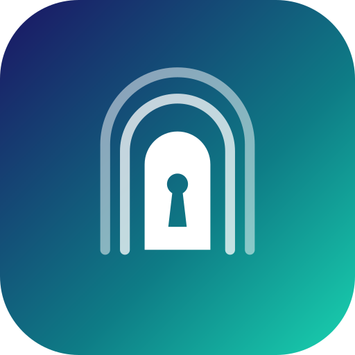

<p align="center">
  
</p>

# Passage: Gopass & age Password Store para Android

[](https://github.com/celson/pass-store-age/actions/workflows/build.yml)
[](https://github.com/celson/pass-store-age/releases/latest)
[](https://github.com/celson/pass-store-age/releases)
[](LICENSE)


A modern Android app that reads, manages and syncs **gopass**-compatible secrets, encrypted with **age**, in remote **Git** repositories.

---

## 🏗️ System Architecture

```text
├── age-mobile/                          # Native cryptographic engine in Rust (UniFFI)
│   ├── src/                             # age encryption (ASCII/binary), gopass parser, SSH/X25519 keys
│   ├── build-android.sh                 # Cross-target build for the Android ABIs
│   └── generated/kotlin/                # Kotlin code generated by UniFFI (app.passage.crypto)
│
└── android/                             # Multi-module Android Gradle project
    ├── app/                             # Application, MainActivity (FLAG_SECURE), DI (Koin), Navigation
    ├── core/
    │   ├── crypto/                      # Kotlin facade with JNI and the age-mobile bindings
    │   ├── git/                         # Git engine (JGit), SSH keypair manager, conflict resolution
    │   ├── domain/                      # Domain models, use cases and repository contracts
    │   ├── security/                    # Keystore, biometrics, clipboard auto-clear and TOTP (RFC 6238)
    │   └── database/                    # Room database (local metadata index for fast search)
    └── feature/
        ├── vault/                       # Compose UI: folder tree, search and FAB
        ├── secret-detail/               # UI: reveal/copy password, attributes, notes and 2FA/TOTP card
        ├── secret-editor/               # Create/edit secrets + entropy-based password generator
        ├── sync/                        # Git dashboard, public SSH key export and conflicts
        └── autofill/                    # Android Autofill Service (auto-fill in Chrome/apps)
```

---

## 🔒 Security and Usability Features

1. **Local Zero-Knowledge:** No secret is ever written to disk decrypted. The Git clone keeps the `.age` files intact.
2. **Window Protection (`FLAG_SECURE`):** Blocks screenshots and screen recording, and hides sensitive data in Android's app switcher.
3. **Secure Clipboard:** Password copies use `EXTRA_IS_SENSITIVE` (Android 13+) and are cleared automatically after 30 seconds.
4. **Built-in 2FA / TOTP Token Generator:**
   - Detects gopass-compatible `otpauth: otpauth://totp/...` attributes.
   - Generates 6-digit codes in real time, with a circular 30-second countdown ring and a quick-copy button.
5. **Autofill Service (Android Autofill Framework):**
   - Intercepts website access in Chrome/browsers and login forms in native apps.
   - Matches the web domain or package name against the local index and fills in username and password with one tap.
6. **Strong Password Generator:**
   - Configurable length (8 to 64 characters), filters for uppercase, lowercase, digits and symbols, with an option to avoid ambiguous characters (`0/O`, `1/l/I`).
   - Real-time entropy calculation in bits and a strength rating.

---

## ⚡ Building

### 1. Test and Build the `age-mobile` Engine (Rust)
```bash
cd age-mobile
cargo test
./build-android.sh
```

### 2. Open the Android Project
Open the `android/` folder in **Android Studio** (Koala / Ladybug or newer). Gradle will automatically sync all dependencies declared in `gradle/libs.versions.toml`.
